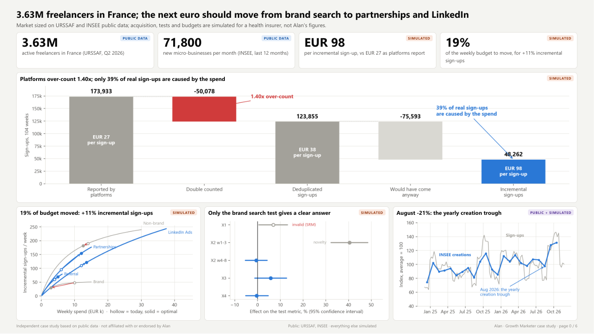

# Growing the freelancer segment: where the market is, what really drives sign-ups, where the next euro goes

**[Read the report (PDF)](https://albt-france.github.io/alan-freelancer-growth-case-study/report/alan_freelancer_growth_case_study.pdf) · [Open the growth planner](https://albt-france.github.io/alan-freelancer-growth-case-study/dashboard/)**

<sub>Repository copies: [site/report/alan_freelancer_growth_case_study.pdf](site/report/alan_freelancer_growth_case_study.pdf) · [site/dashboard/index.html](site/dashboard/index.html)</sub>

A Growth Marketer case study on one growth problem: **how a health insurer grows the freelancer segment in France**, from diagnosis to a 90-day plan.
The market is sized on **real public data** (URSSAF, INSEE, Etalab). The insurer's channels, spend, sign-ups, tests, creatives and referrals are **simulated** (seed 42), calibrated on that public data, and labelled PUBLIC DATA, SIMULATED or PUBLIC + SIMULATED on every visual. They are fictional and are not Alan's figures.



## Four key results
1. **The market (public data).** 3.63M self-employed in France (Q2 2026); 1.66M auto-entrepreneurs actually trade, only 55% of those registered; 71,800 new micro-businesses a month, with a trough every August.
2. **Reported is not real, real is not incremental (simulated).** Platforms over-count 1.40x. Per incremental sign-up the cost is EUR 98, not EUR 27 as reported. Switching brand search off in 6 regions lost 1% of its sign-ups (at most 20%): the rest came back as organic.
3. **Tests that would have misled (simulated).** The landing-page test "won" by +7% but its split was 51.7 / 48.3: invalid. The bigger referral reward gave +40% for three weeks, then -1%. LinkedIn claimed 1,268 extra sign-ups in the geo test; the test finds 243 (at most 535). The August alert of -21% is +4% once deseasonalised: no alert.
4. **Where the next euro goes (simulated).** Moving 19% of the weekly budget from brand search to partnerships and LinkedIn Ads adds +11% incremental sign-ups at the same total. Creatives lose -48% CTR after the 4th exposure; 12 referral codes brought 361 referees and no active member.

## What is in the repository
| Path | Content |
|---|---|
| `sql/` | DuckDB: `00_staging` to `08_alerts` (CTEs, window functions), plus `99_tests.sql`: 20 tests, including `E1`-`E8` (the 8 simulated events) and `F1` (false signal not escalated). |
| `src/` | `download_public.py` (polite, cached), `simulate_growth.py` (seed 42), `run_sql.py`, `stats.py` (intervals, SRM chi-square, difference-in-differences), `allocate_budget.py` (optimiser on response curves), `key_numbers.py`, `charts.py`, `build_pdf.py`, `build_dashboard.py`. |
| `tools/glance_check.py` | Checks the PDF reads at a glance (words per page, number of charts, chart area) and renders previews. |
| `notebooks/freelancer_growth.ipynb` | One executed notebook: market → funnel → attribution → experiments → creatives and referral → allocation → plan. |
| `docs/` | Business documents: problem brief, ICE prioritisation, experiment log, channel playbook (incl. AI search measurement protocol), creative testing framework, referral guardrails, measurement plan, 90-day plan, sources, assumptions, data issues. |
| `site/` | GitHub Pages: landing page, PDF report, growth planner (one self-contained page: budget allocator, experiment calculator, market map). |
| `data/public/`, `data/sim/`, `data/output/` | Derived public tables (ODbL), simulated data, SQL and statistics results. |

## Methods
- **Market:** URSSAF quarterly auto-entrepreneur counts by departement and sector, self-employed income by departement, INSEE monthly creations (raw and seasonally adjusted). Market value of a departement = active auto-entrepreneurs x average income.
- **Simulation:** 104 weeks x 6 channels x 5 sub-segments x 13 regions; demand follows the INSEE creation seasonality (elasticity 1.6) and URSSAF geography; diminishing returns per channel (Hill curves); 4 experiments, 120 creatives, referral codes; 8 planted events, each found by a rule and a test.
- **Incrementality:** geo tests read by difference-in-differences (bootstrap over 20 matched departement pairs; Poisson resampling for the regional holdout). Departements matched on public URSSAF data.
- **Experiments:** z-tests with 95% intervals, chi-square sample-ratio check, week-by-week lift to catch novelty, conversion read within sub-segments (Simpson's paradox).
- **Allocation:** same budget, split to maximise incremental sign-ups on the response curves within practical bounds (brand defence minimum, partner capacity, referral volume).
- **Alerts:** monthly sign-ups deseasonalised with the INSEE seasonal factor (elasticity estimated from month-over-month log changes).

## How to re-run
From the repository root (Windows, Python 3.10+, Microsoft Edge for the PDF):

```
pip install -r requirements.txt
python run_all.py
```

`run_all.py` runs, in order: `src/download_public.py` (cached; `data/public/` already holds the derived tables), `src/simulate_growth.py`, `src/run_sql.py` (SQL + 20 tests), `src/stats.py`, `src/allocate_budget.py`, `src/key_numbers.py`, `src/compare_truth.py` (skipped in the published copy), `src/build_dashboard.py`, `src/build_pdf.py`, `tools/glance_check.py site/report/alan_freelancer_growth_case_study.pdf`, then executes the notebook.

## Sources and licences
| Source | Use | Terms |
|---|---|---|
| URSSAF open data: auto-entrepreneurs by departement, by departement and sector; active self-employed; income by departement | market size, map, sectors, income, simulation weights | **ODbL**: the derived tables in `data/public/` and `data/output/` are shared under the ODbL |
| INSEE BDM series 010755410 (raw) and 010755411 (seasonally adjusted) | seasonality, simulation calibration, alerts | Licence Ouverte / Etalab 2.0 |
| Etalab departement boundaries 2025 | maps | Licence Ouverte / Etalab 2.0 |
| Nager.Date public holidays | holiday weeks | open API |
| Job posting "Growth Marketer" (Ashby, published 18/11/2026); SIRENE | scope of the role; employer identity check | quoted facts only |

All sources read on 27/11/2026, details in [docs/sources.md](docs/sources.md).

## Limits
- Everything about the insurer's acquisition is simulated: the method transfers, the numbers do not.
- Channels without a test (non-brand search, partnerships, referral, AI search) use assumed incremental shares, labelled as such.
- The LinkedIn geo test interval includes zero: the direction is clear, the size is not.
- INSEE changed its counting method in 2022: seasonality is read within the series, levels are not compared across 2022.
- No AI assistant was queried: AI search visibility is a proposed measurement protocol, not a measurement.
- No legal or tax rule is used in the analysis.

## AI note
AI-assisted workflow: I used Claude, mainly to write scripts faster. I drove the project: I defined the questions, chose and validated the data sources, made the analytical decisions and checked every result.

---
Independent case study based on public data · not affiliated with or endorsed by Alan
